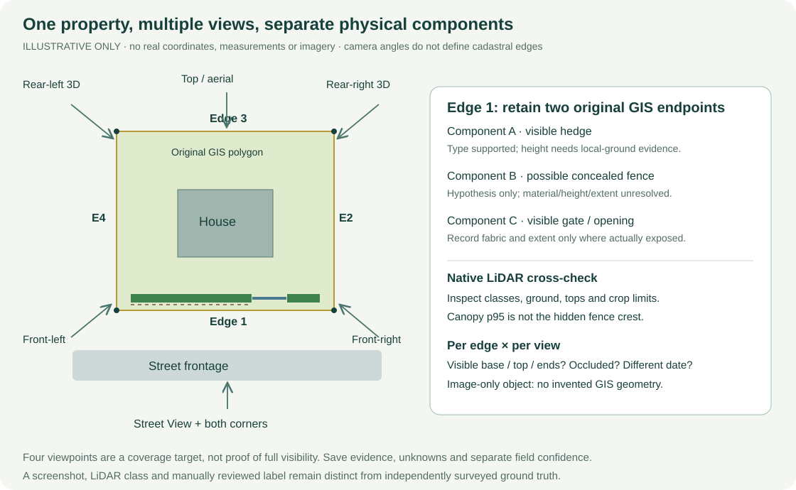

# Boundary-object prediction methodology

**Auckland FlowLab · 16 October 2026 · local research prototype.**
This document describes the implemented boundary registry, crossed-edge screening
and skill-guided interpretation. Use [README](README.md) for installation,
website operation and export routes. It is not a hydraulic formulation, cadastral
survey, calibrated AI accuracy report or property flood-risk assessment.

## Contents

1. [What we predict](#what-we-predict)
2. [Sources and coordinate systems](#sources-and-coordinate-systems)
3. [Method A: batch LiDAR screening](#method-a-batch-lidar-screening)
4. [Method B: skill-guided multi-view review](#method-b-skill-guided-multi-view-review)
5. [Fields, confidence and heights](#fields-confidence-and-heights)
6. [Worked examples](#worked-examples)
7. [Persistence and exports](#persistence-and-exports)
8. [Validation and accuracy claims](#validation-and-accuracy-claims)
9. [Reproducibility and completion checklist](#reproducibility-and-completion-checklist)

## What we predict

The unit of work is an **original property edge and its nearby physical
components**, not the whole house assigned one fence label.

We retain three different geometries:

- **Property polygon:** original published geometry, with rings/holes/multiparts.
- **Boundary segment:** consecutive original vertices form a two-endpoint
  LineString; no simplification or invented densification. Eight straight sides
  produce eight records. A legal boundary is not a surveyed fence location.
- **Object/component:** a mapped feature, fitted native-return envelope, candidate
  line or visually interpreted component. Its geometry may be offset from the
  boundary, or null when it cannot be georeferenced responsibly.

An edge can contain hedge + concealed possible fence + gate/opening + adjacent
building. Keep separate components and extents, with a `mixed` parent where
appropriate. Do not label the entire line a solid wall because one part is built.
Do not assume ownership from proximity or manufacture a GIS point from a pixel.

Boundary IDs use canonical millimetre-rounded endpoint pairs; reversing a ring
or changing its start vertex does not rename an identical edge. Identical full
segments may share an ID between properties. This does not resolve unmatched
T-junctions or prove the same physical object has been detected twice. See
[properties.py](src/floodtwin/properties.py) for actual identity/topology logic.

### Crossing-only scope

For the regional batch, select edges with a **proper geometric crossing** of an
available Council mapped overland-flow line. Touching an endpoint, overlapping
collinearly, running parallel or merely being nearby is not a proper cross.
Missing source coverage gives an unknown relation; a successful empty query is
not a missing layer. Use original GIS geometry, not an AI-drawn flow trace.

Separately test whether an object's saved geometry intersects the matched flow
and lies within the recorded tolerance of the boundary/flow intersection. A
parent-edge crossing does not automatically propagate to every linked object.
Image-only components have unresolved geometry and cannot pass a spatial
intersection test. These are mapped-data screening relationships, not observed
water movement, permeability or obstruction severity.

## Sources and coordinate systems

| Source | Used for | Must not be interpreted as |
| --- | --- | --- |
| LINZ official address + property/parcel source | Property identity, published polygon and original attributes | A guessed address match or interchangeable rating-unit/parcel identifier |
| LINZ building outlines | Spatial context and footprint masks | Architectural walls, roof shape or surveyed eave height |
| Auckland Part 1 2024 native LiDAR LAS/LAZ | Measured returns, survey classes/flags, local shape/height evidence | Complete observation of every fence/wall; absence proves nothing under occlusion |
| Verified 1 m DEM | Bare-earth reference for above-ground estimates | A direct measurement of a narrow fence base or crest |
| 1 m DSM | Surface context and display fallback | A reliable fence detector or bare-earth terrain |
| LINZ 7.5 cm aerial, collection 2024–25 | Plan-view planting, built edges, roofs and openings | Pixel size equals positional accuracy, or unseen material/foundations are measured |
| Google Earth top + photorealistic 3D | Independent viewpoints for visible shape, components and identity | Authoritative cadastral positions or undistorted, measured fence geometry |
| Street View / consented supplied photos | Frontage fabric, gaps, gates, wall/fence details hidden from above | Current conditions or correct property identity solely from the displayed address |
| Council flow/asset layers | Mapped relationships, original attributes and context | A live storm, verified drainage network or certified flood risk |
| Supplied GDB/manual checks | Potential reference geometry and explicit assessments | A complete labelled truth set simply because the filename says groundtruth |

Preserve provider, URL, local artifact/hash, source feature ID, licence/status,
retrieval/review date, **imagery/survey date**, CRS/datum and limitations.
Retrieval date, imagery capture date and service edit date are different facts.
An unverified capture date remains null. Do not silently fuse structures from
different years into an allegedly current complete inventory.

Use **NZTM2000 EPSG:2193 metres** for distances/intersections and **NZVD2016** for
verified normal-orthometric elevations. The native point-cloud metadata checks
compound horizontal EPSG:2193 + vertical EPSG:7839. DEM tags must establish the
vertical datum, not merely the collection title. A 2D source line has no invented Z.
GeoJSON/browser interchange uses longitude, latitude (`OGC:CRS84` order), not
latitude, longitude. Any display conversion to Earth ellipsoidal height must be
recorded separately and must not overwrite original NZVD2016 measurements.

Source starting points and cautions: [SOURCES](SOURCES.md),
[LINZ Data Service](https://data.linz.govt.nz/data/),
[Council mapped flow service](https://services1.arcgis.com/n4yPwebTjJCmXB6W/arcgis/rest/services/Overland_Flow_Paths/FeatureServer/0),
and the actual per-property source manifests. Discover Part 1/Part 2 coverage
by intersection rather than assuming a survey from an example address.

### Area and completeness

The pilot is tile **BA31_1000_4245**, NZTM
`[1753120, 5915760, 1753600, 5916480]` (480 × 720 m), within the event's broader
Mt Albert context. Detailed confirmed properties may use their own smaller local
point crops outside that rectangle. “All” in a registry export means all saved
records within the stated scope, not every suburb property or every source tile.
Every export must keep its actual coverage and incomplete-inventory flags.

## Method A: batch LiDAR screening

**Purpose:** fast, reproducible triage of crossed edges using local source data.
This is deterministic class/geometry screening with an explicit visual-atlas gate,
not a newly trained deep-learning fence/wall detector and not a remote model call.

Current implementation:
[crossing_detection.py](src/floodtwin/features/crossing_detection.py), version
`native-crossing-corridors-v2`. Its run archives the exact detector file and input
hashes. The thresholds below describe that version, not universal physical rules.

### A1. Prepare trustworthy inputs

1. Read the saved pilot manifest and original property records.
2. Select only properly crossed pilot edges; deduplicate identical edge IDs for
   computation while retaining every property's associations.
3. Verify native LAS/LAZ and DEM coordinate/datum metadata; hash native source
   files, exact detector code and source property revisions.
4. Preserve all raw points/flags. For usable detection evidence exclude withheld
   points, noise classes 7/18 and nonfinite DEM-relative heights.
5. Query actual returns within **1 m either side** of each original straight edge,
   not a DSM-only substitute. Use local along/across-edge coordinates.

The older generic registry linear-candidate routine is separate: it looks for
narrow unclassified returns around 0.3–3 m. Do not confuse that routine with the
newer regional crossed-only detector described here.

### A2. Group observed returns

For the current crossed-only detector:

| Rule | Current setting |
| --- | --- |
| Relative-height QC | −0.5 to 40 m above the nearest 1 m DEM cell; along-edge position inside segment |
| Vegetation group | Survey classes 3/4/5, relative height at least 0.3 m |
| Building group | Survey class 6, relative height at least 0.5 m |
| Ambiguous low group | Classes 0/1, relative height 0.25–4 m; exclude mapped building footprints buffered by 0.25 m |
| Along-edge bins | 0.5 m; split occupied runs when successive bin indices differ by more than two |
| Minimum group | 12 returns; span at least 0.75 m for vegetation/building or 1.5 m for ambiguous groups |
| Additional ambiguous-group filter | p95–p5 lateral spread ≤1 m and occupied-bin fraction ≥0.65 |
| Object geometry | Return convex hull clipped to the 1 m edge corridor |
| Height summary | Observed p10, median and p95 above DEM; p95 stored as return-envelope height |

These filters can miss sparse wire fences and can accept vegetation, vehicles or
other clutter. A hull is **not** measured object thickness or a surveyed physical
outline. Ground/trees/roofs do not become walls just because they are near a line.
Height QC is a screening choice, not evidence that discarded points cannot be real.

### A3. Classify cautiously

Native clusters initially become `vegetation`, `building` or `unknown`. A parent
becomes `mixed` when groups differ. Unresolved unclassified linear groups are not
automatically called fences. Parent height may remain null because one number
would wrongly describe different components.

Current heuristic type scores are 0.75 for vegetation, 0.80 for buildings and 0
for unresolved native groups; a mixed parent gets 0.65. Native height scores are
0.45 with at least 30 group returns, otherwise 0.30. These are implementation
heuristics, **not measured probabilities**. Exact values live in source; changing
them is not an accuracy improvement without evaluation.

### A4. Review the atlas before publication

`prepare(root)` generates an oriented aerial strip and native class/height
profile for each distinct crossed edge, grouped into atlas pages. A reviewer must
actually inspect every page. The publication review binds its run ID, evidence
JSON hash and all atlas-page hashes; a file's existence is not visual QA.

Authored visual refinements may identify a supported hedge or add a provisional
image-only fence component. They need reasons, alternatives and numeric evidence
scores. Image-only components retain `geometry: null`, no invented height and an
unresolved spatial crossing. Do not silently generalise those few reviewed cases
into semantic classifications for the entire pilot.


Actual local screenshot, case E026. Yellow is the selected cadastral edge; cyan
is mapped flow. The profile/planting supports a hedge interpretation but does not
measure an underlying fence. Source attribution remains in the screenshot.

### A5. Publish a versioned local overlay

`publish(root, run_id, review_path)` rejects stale inputs, missing/extra target
edges, invalid geometry, inconsistent labels and unsupported risk/depth values.
It archives previous detection bundles and writes only crossed-edge prediction
overlays. It does not rewrite raw property geometry, non-crossed edges or manual
reviews. The saved batch has `google_views_acquired: false` in its evidence and
`accuracy_validated: false`; it must not be described as Google-reviewed.

Python entry points are actual implementation functions, **not new CLI commands**:

```python
from pathlib import Path
from floodtwin.features.crossing_detection import prepare, publish

root = Path('/work')  # only inside the detected compatible Docker runtime
# result = prepare(root)  # creates evidence; does not publish reviewed predictions
# Visually inspect ALL resulting atlas pages, then author a hash-bound review.
# publish(root, result['run_id'], Path('/work/data/private-atlas-review.json'))
```

Commented calls are intentional: do not rerun/publish merely to read this guide.
Large regional batches do not receive full multi-angle review automatically.

## Method B: skill-guided multi-view review

**Purpose:** higher-evidence, property-specific interpretation by an assistant
following a reproducible procedure. It combines semantic interpretation of actual
images with authoritative GIS anchors and native height evidence. It is not a
standalone unattended service, a guarantee of accuracy or a survey.

Read the [complete skill](skills/property-boundary-review/SKILL.md) and its
[field/storage contract](skills/property-boundary-review/references/fields-and-persistence.md)
before authoring saved records. The skill is a procedure, not a model weight file.
No new AI API/key/model training pipeline is installed by invoking it.

### B1. Invoke it with an explicit scope

Example assistant instruction:

```text
$property-boundary-review
Review 3A Sadgrove Terrace and 23 Kitenui Avenue in this repository.
Use the confirmed parcel and retain every original edge ID/endpoints.
Acquire a numbered top view, four distinct close Google Earth obliques and
Street View frontage/corners where available; also inspect original aerial,
native LiDAR, classes and local-ground profiles. Use permitted supplied images
where browser coverage fails. Record failures and missing views explicitly.
Identify separate fences, walls, hedges, gates, openings and adjacent components.
Assess every field with source references and separate numeric type/height
confidence; do not invent hidden dimensions or calibrated accuracy.
Save versioned local proposals, preserve manual reviews, prefill the 3D editor
and verify edge selection, fields and JSON exports visually. No deployment,
remote model API, hydraulics or full test suite.
```

For regional triage add: **“Only process original edges whose saved mapped-flow
relation is a proper cross; retain all other records unchanged.”** Report partial
coverage rather than suggesting every edge received four-angle review.

### B2. Match the property before interpreting it

Use roof/chimney, driveway/outbuildings and neighbouring houses/street layout to
match the target. Street View's displayed address can refer to the nearest camera
position; a caption alone is not identity proof. Record both target and displayed
addresses and why they match. Reject an ambiguous view for definite assignments.

Load every original edge ID/endpoints and create a numbered top-view reference.
Derive bearings from GIS; do not let “left/rear” silently change with camera angle.
Distinguish a neighbouring access drive from an opening in the target property.

### B3. Acquire complementary views with Playwright

Use the installed Playwright skill/available connector and a real headed browser.
Check the actual browser/session tools first; do not claim an inaccessible personal
tab is available. Normal provider UI and supplied images are permitted evidence;
bulk tile scraping, access-control bypass and training-data extraction are not.

Target coverage per property:

1. One numbered aerial/top view exposing the complete property polygon.
2. Four close obliques: front-left, front-right, rear-left, rear-right or equivalent
   genuinely different headings around the property.
3. Street-level frontage and both corners, plus useful side/gate viewpoints.
4. Native LiDAR plan/profile and ground-reference evidence for each relevant object.



Conceptual capture plan only, not a real cadastral or fence measurement.

In the browser, snapshot before using element references and refresh after UI
changes. Search the confirmed property, inspect top view, then tilt/orbit to expose
each side. Stop orbiting, let imagery/mesh settle, inspect and capture. Use
accessible heading/tilt controls when available; handle accessibility prompts or
blocking tips once rather than repeatedly clicking an intercepted control.
Google Earth has required enabling accessibility before keyboard interaction in
this project. A changed URL/slider is not proof the rendered viewpoint changed.

Record observed headings only when available; otherwise use descriptive view
labels. Inspect thin objects close up. Four near-identical screenshots or a
dramatic mesh view do not establish boundary-base visibility. Do not interpret
texture stretching, roof spikes or neutral display sides as physical fences.

If Street View fails, try one normal alternative such as Earth Street View or a
nearby road point. If still unavailable, record the actual error and finish a
partial review using matched supplied photos where possible. A failed view cannot
increase confidence and does not prove the street lacks coverage.

### B4. Record an edge-by-view observation matrix

For every edge/component, record view IDs exposing its base, crest, ends and
intermediate span, plus hidden parts and date conflicts. Classify observations as
directly visible, reasonable estimate, LiDAR-only candidate, occluded/unresolved,
or positively observed opening. “Nothing visible” under a tree is not an opening.

For each component retain ID, parent edge, type, position/extent note, actual
geometry or `relative_image_position_only`, alternatives, field assessments,
sources and confidence. Keep both hedge and possible underlying fence hypotheses
without inventing the concealed fence's material, extent or height.

### B5. Use native LiDAR to constrain dimensions

Inspect original points, not just the textured 3D display. Hide display roofs/sides
and terrain where necessary. Check points beneath vegetation, return classes,
ground on both sides, gaps and crop boundaries. Survey classification can be
wrong; a fence may be unclassified, labelled vegetation or unobserved.

Associate the height sample with the actual object before estimating a crest.
The basic native evidence is point Z minus co-located verified DEM ground. The
DEM is a 1 m support grid and can be biased around slopes/walls. Preserve ground
uncertainty and explicitly separate canopy, roof, hedge top and wall/fence crest.
An entire corridor's p95 can simply be the tallest tree above a short fence.

Visual dimension estimates require a defensible reference and perspective/date
caveats. Camera altitude, nominal car/door sizes or assumed fence regulations are
not exact measurement references. Below-ground depth usually cannot be observed.
Record null with a reason rather than manufacture a plausible number.

### B6. Save and visually verify

The sample adapter in [sample_evidence.py](src/floodtwin/features/sample_evidence.py)
uses `prepare(root, workspace_id)` for evidence and `save_sample(root, pid,
draft_path)` to validate an **already authored** draft. For the existing samples,
`save_visual_sample(root, pid, review_path)` applies a hash-bound authored visual
revision. The initial draft must cover every required original edge exactly once;
components do not replace its original topology. These helpers do not call a
remote model. Read their current contracts before constructing an input file.

Store browser evidence under `output/playwright/<property-id>/` with attribution,
source URL, imagery date or explicit unknown, capture date and local SHA-256.
Conversation-only attachments retain attachment IDs/references; do not invent
local artifact paths or hashes. Deduplicate repeated uploads as one view. Ensure
the runtime can actually access any cited local screenshot; `output/` may not be
mounted inside the current container.

Archive prior predictions; preserve original sources and existing manual reviews.
On the actual 3D page select each original line in LiDAR and Earth modes. Check
that the selected ID, component inventory, source notes and form values agree.
Fresh supported predictions may prefill as **unsaved/unverified**; reviewed values
win and stale/context-only predictions must not prefill. Explicit Save is required
for a user review. Verify downloaded JSON/GeoJSON against the displayed entity.

## Fields, confidence and heights

Every field needs an assessment, even when unresolved: `status`, confidence,
`basis` and `source_ids`. Do not equate “all fields assessed” with “all physical
values known.” Existing compatibility enums remain supported, but numeric
classification scores are stored separately and never mechanically translated
from words such as “high” or “fairly.”

| Field | Supported interpretation and required restraint |
| --- | --- |
| Type | `fence`, `wall`, `retaining_wall`, `hedge`, `vegetation`, `gate`, `building`, `kerb`, `bund`, `mixed`, `other`, `unknown`; label components separately |
| Material | Visible/estimated fabric, or null if concealed; green does not mean timber/concrete |
| Height | Object-specific above-ground estimate/range + method; null if association/ground/crest is unresolved |
| Width | Physical cross-boundary thickness/spread, not edge length or native return hull width |
| Depth | Buried/embedment depth, normally null; not hedge spread or retaining-wall height |
| Continuity | Only over the observed/mapped extent; gaps in airborne points may be occlusion |
| Permeability | Qualitative fabric observation where supported; visible gaps do not establish numeric hydraulic porosity |
| Potential influence | Labelled screening hypothesis only; not validated storm behaviour |
| Mapped crossing | Original GIS relationship with separate parent/object semantics |
| Risk | Unassessed without an appropriate validated assessment; not inferred from an image confidence score |

### Numeric confidence is per field, not accuracy

`classifications.type` and `.height` each contain a label and `confidence_score`
in [0,1], displayed as 0–100%. Assistant scores record
`confidence_method: assistant_subjective_uncalibrated` and `calibrated: false`.
Local detector scores are explicitly heuristic and likewise uncalibrated.

A 90% hedge score does not mean 90% detection accuracy, 90% confidence in its
height/material, or a 90% hydraulic obstruction probability. An unresolved physical
assignment has a zero assignment score; that does **not** mean a 0% chance an
unseen object exists. Extra views increase a score only with a documented new
observation. Conflicting dates or hidden bases may reduce confidence.

Actual height labels in [classifications.py](src/floodtwin/features/classifications.py):

| Label | Metres |
| --- | --- |
| `under_0_5_m` | <0.5 |
| `0_5_to_1_m` | 0.5 to <1 |
| `1_to_2_m` | 1 to <2 |
| `2_to_3_m` | 2 to <3 |
| `3_to_5_m` | 3 to <5 |
| `5_to_10_m` | 5 to <10 |
| `10_m_or_more` | ≥10 |
| `variable_height` | Mixed components without a single defensible height |
| `unresolved` / `not_applicable` | No physical numeric assignment / nonphysical context |

Keep the estimate/range and its sampling basis alongside the label. A p10–p90
return spread is not a calibrated confidence interval. Rounding to centimetres
does not imply centimetre measurement accuracy.

## Worked examples

### Example 1: Google top view establishes layout; an oblique adds visibility


Top view: useful for roof/driveway/neighbour matching and layout, not legal
boundary reconstruction. Google attribution and source UI are retained. The
displayed imagery date in this capture is 18 March 2024; it is not automatically
the date of Google's 3D geometry.


Oblique: shows vertical form and planting that a plan view alone cannot explain.
This captured overview does not itself meet the close-up four-angle target.
The saved sample also references the user's distinct close obliques and supplied
street-level image; conversation-only attachments are not manufactured as local
PNG files. Their property identity and visibility limitations remain documented.

Browser-acquired Street View failed in the recorded session (metadata HTTP 500 /
panorama HTTP 403; Earth Street View also showed no data). Successful supplied
street evidence is a separate source, not proof that the browser attempt worked.

### Example 2: a hedge can have stronger type evidence than height evidence

Actual 23 Kitenui frontage edge `edge_7b280d96d3ee419899199737`:

- Original NZTM endpoints: `[1753589.3994706508, 5916761.210865859]` and
  `[1753599.485437668, 5916775.7614989765]`; no invented Z.
- Saved type: **hedge**, subjective score **0.90**.
- Saved height class: **2_to_3_m**, score **0.55**, estimated median **2.34 m**.
- Height evidence: 179 of 349 vegetation returns selected within 0.5 m of the
  original edge, with an explicitly assumed 0.4–3.5 m height filter to reduce tall
  canopy; observed p10/median/p90 **1.79/2.34/2.75 m**.
- Clipped planting is supported by matched views. The filter is not perfect
  semantic isolation of a hedge. Base/exact endpoints are partly hidden; a
  concealed fence remains unresolved. The estimate is not a surveyed crest.

This is why we store different confidence scores instead of copying the type
score into every dimension. The corresponding
[actual 3D editor screenshot](output/playwright/kitenui-numeric-classification.png)
shows both labels/scores and numbered edges.

Abbreviated excerpt of that saved result (not a complete import/review payload):

```json
{
  "entity_id": "edge_7b280d96d3ee419899199737",
  "entity_kind": "boundary_segment",
  "type": "hedge",
  "height_m": 2.34,
  "classifications": {
    "confidence_method": "assistant_subjective_uncalibrated",
    "calibrated": false,
    "type": {"label": "hedge", "confidence_score": 0.9},
    "height": {
      "label": "2_to_3_m",
      "confidence_score": 0.55,
      "value_m": 2.34,
      "range_m": [1.79, 2.75]
    }
  }
}
```

The full export also retains original GIS endpoints, the height sampling basis,
ten field assessments, source IDs, components, review state and source revision.
Do not copy these example labels/scores to another edge or property.

### Example 3: an L-shaped reference line does not have a verified fence type


Actual GDB OBJECTID **875**, GlobalID
`{0DD09C0B-9289-4FC6-8607-A50FF6D14841}`, length 24.08 m. Yellow is the supplied
reference geometry, **not** a reconstructed/surveyed fence. Aerial and native
profiles support an L-shaped hedge interpretation. A possible underlying built
barrier is concealed. Within its exact 1 m corridor the native p95 is about
2.50 m; overlapping detection clusters have 3.44/3.78 m envelopes over different,
broader supports. Neither statistic establishes an actual fence-height error.

The source GDB's type/assessment fields are null. The visual review is saved in
a **separate diagnostic report**, not inserted as groundtruth or automatically
published into existing predictions. See
[the four-object report](output/groundtruth-four/report.md),
[874 evidence](output/groundtruth-four/object-874.png),
[739 evidence](output/groundtruth-four/object-739.png) and
[873 evidence](output/groundtruth-four/object-873.png).

Real PNG examples are private local artifacts under ignored `output/`; source
checkouts carry the conceptual SVGs but intentionally omit these property images.
Keep original attribution and review sharing permissions before packaging them.

## Persistence and exports

The active store is the JSON registry under ignored `data/property-registry/`:

| Directory | Role |
| --- | --- |
| `raw/` | Original publisher responses/attributes, metadata and native assets |
| `properties/` | Canonical property polygon, individual edges, source evidence and links |
| `reviews/`, `object-reviews/` | Explicit saved user decisions; survive evidence regeneration |
| `assistant-drafts/`, `sample-evidence/`, `predictions/` | Authored sample inputs, inspected evidence and validated proposals |
| `prediction-history/` | Archived prediction revisions |
| `crossing-detection-runs/` | Exact detector, hashes, native/aerial atlas, review and publication record |
| `crossing-detections/` | Crossed-only per-property prediction overlays |
| `evaluations/` | Separate validation reports, never training truth by default |

The registry merges overlays for reading. Canonical revisions/hashes detect stale
proposals. Manual review takes precedence; existing fresh detailed sample
predictions are not silently replaced by a coarser regional detection. A proposal
is not a source fact or saved human review. Back up these directories together;
never delete histories/raw inputs to make predictions appear current.

Exports preserve original endpoints/attributes, object IDs, sources, inferred
components, per-field assessments and review status. Large native assets are
referenced with hashes rather than copied into every JSON. PostgreSQL is an
optional configured service, **not** the implemented automatic registry backend.

Regional JSON selection is implemented in
[crossing_export.py](src/floodtwin/features/crossing_export.py). Preserve:

- `crossed_boundaries`: original proper-crossing edge records and intersections;
- `objects`: property-scoped linked source/predicted/image-component records;
- `objects[].associations`: near-crossing distance, intersects/properly-crosses
  flags, tolerance and unresolved relationship status;
- `crossing_object_ids`: stricter object-geometry intersection plus proximity
  subset; null geometry is not assumed to intersect;
- `scope`, sources, errors and unclassified/unlocated counts.

Do not count a repeated source object at two properties as two distinct physical
structures. Do not treat broad return hull intersection as proof of a solid
barrier across a water route. Source asset types and AI-inferred semantic types
retain different `type_status` values in the export.

## Validation and accuracy claims

There are four different checks:

1. **Software/schema:** IDs, endpoints, topology, finite numeric fields, score
   ranges, stale-input protection, crossing semantics, history/review precedence.
2. **Visual QA:** correct actual scene, selected line, source visibility, form
   values and downloads. A successful HTTP request or click alone is not visual QA.
3. **Same-source consistency:** native points versus same-survey DEM, geometry
   coverage and spatial proximity. Useful diagnostics, not independent accuracy.
4. **Independent validation:** matched reference objects/negatives, explicit type
   labels and independently measured dimensions. This is required for accuracy.

### Current supplied groundtruth result

The read-only evaluator
[groundtruth_check.py](src/floodtwin/validation/groundtruth_check.py) read 1,443
valid EPSG:2193 reference lines. Only **739, 873, 874 and 875** overlap the current
pilot/crossed corridors. All four genuinely have null type/assessment/comment
fields. The GDB contains one layer with no related assessment table and no
dedicated measured-height field. Its 0/1/2/3 domains mean **None/Low/Medium/High
obstruction severity**, not fence/wall types. Missing is not an explicit negative.

Across the entire GDB, 251 rows carry some assessment information; the nearest
assessed reference is approximately 1.98 km from the pilot. Separate sibling
team checks are visual observations, not field measurements, and none overlaps
these exact four objects. Nearby fence labels must not be copied onto them.
Sibling Claude labels are explicitly unchecked AI development labels, not an
independent test set for our predictions.

All four reference lengths lie within a 1 m buffer of saved native detection
envelopes. That is **spatial agreement**, not 100% type accuracy or recall.
Imported reference features were excluded from predictions being evaluated to
avoid rewarding copied groundtruth. Actual broad visual findings are vegetation
at 739/873 and likely hedges at 874/875, with hidden barriers unresolved.

Consequently type accuracy, detection precision/recall, barrier-height MAE and
obstruction-severity accuracy are **null/not evaluable**, not zero and not 100%.
Subjective confidence scores have not been empirically calibrated by this overlap.

### How to establish actual accuracy

Before making a numerical accuracy claim:

1. Freeze the prediction run/code/input hashes and matching tolerance **before**
   opening withheld reference labels. Keep training/development cases separate.
2. Build independently reviewed exact object geometry/types, explicit absence
   coverage and measured dimensions with dates, local ground, datum and provenance.
3. Define compatible type taxonomy and rules for mixed/occluded objects, partial
   matches, shared edges, multiple predictions and duplicate physical structures.
4. Match using position **and meaningful along-line extent**, not nearest distance
   alone or the union of broad vegetation hulls. Inspect ambiguous matches.
5. Report detection precision/recall, type confusion matrix/per-class results,
   unresolved/abstained cases and sample counts. Explicitly account for unknowns;
   do not remove them simply to inflate accuracy.
6. Compare like-for-like object dimensions (fence crest to fence crest), report
   height errors and datum/ground uncertainty. Canopy/roof p95 is not fence truth.
7. Test confidence calibration and held-out performance across vegetation,
   occlusion, object type and imagery date. Declare small-sample uncertainty.

A fully visible, matched multi-view review can be much more informative than
batch rules. It becomes “very accurate” only when independent evaluation
demonstrates it for the claimed class, dimension and conditions.

## Reproducibility and completion checklist

Before handing off any prediction batch or property review:

- Confirm original property identity, edge IDs and exact requested scope.
- Record source coverage, CRS/datum, capture/review dates, artifact/code hashes.
- Separate actual data, inferred proposals, synthetic diagrams and manual review.
- State target versus acquired distinct views, which edges remain occluded, and
  every failed acquisition; do not reuse a missing view as confidence evidence.
- Assess every required field with reasons/sources, separate numeric type/height
  scores, alternatives and unknowns. Never invent foundation depth or flood risk.
- Preserve raw sources, prior predictions and existing accepted manual decisions.
- Verify selected edges and fields visually in the same 3D workspace, plus real
  HTTP JSON/GeoJSON; export proper-crossing objects with unresolved cases intact.
- Run only relevant geometry/schema/form/export tests after code changes. For a
  documentation update, validate links, images and Markdown instead of full tests.
- Record actual commands/results, source-versus-synthetic status and next gaps in
  [PROGRESS](PROGRESS.md). Do not imply deployment, browser success, full coverage
  or independent accuracy merely because a document or JSON was saved.

The current documentation consolidates the active method without deleting legacy
research evidence. Historical hydraulic equations/results are kept only in the
[archived methodology](docs/archive/HYDRAULIC_METHODOLOGY_2026-10-15.md); they do not
describe the active boundary-review product or establish obstacle accuracy.
