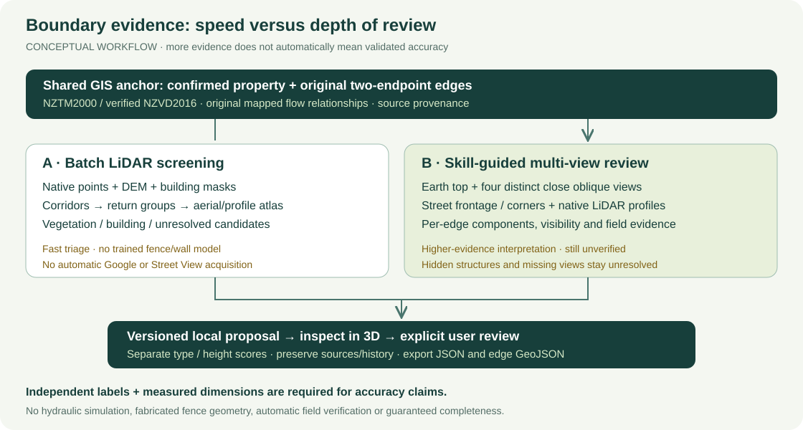

# Auckland FlowLab

Property-boundary and object evidence in one 2D/3D research workspace: official
property polygons, individually selectable boundary lines, native LiDAR,
aerial imagery, optional Google 3D/Street View, editable observations and JSON
exports. Current documentation snapshot: **16 October 2026**.

This is an evidence-review prototype, **not a surveyed fence inventory or a
validated flood-risk product**. The current user-facing scope excludes rainfall,
hydraulic simulation and water animations. Council mapped flow paths remain as
GIS context and as a filter for prioritising boundary-object review. Legacy
solver code and historical results are retained, not part of this workflow.

## Start here

- This README: capabilities, local setup, website workflow, exports and layout.
- [METHODOLOGY.md](METHODOLOGY.md): exactly how we predict, the two methods,
  skill instructions, field semantics, confidence, examples and validation.
- [Review skill](skills/property-boundary-review/SKILL.md) and its
  [field/storage contract](skills/property-boundary-review/references/fields-and-persistence.md).
- [PROGRESS.md](PROGRESS.md): dated execution evidence, failures and caveats.



The diagram is a conceptual workflow, not a real property or measured result.

## What the website does

| Capability | Current meaning |
| --- | --- |
| Partial address search | Suggestions help find an address; the official address/parcel still requires confirmation |
| Property polygon | Original source geometry, including holes and multipart polygons |
| Individual boundary lines | One record for each nonzero straight edge, retaining both GIS endpoints and a stable ID |
| Linked objects | Source GIS assets, native-return candidates, assistant-inferred objects and image-only components, kept distinct |
| One 3D workspace | LiDAR 3D, Earth/Google 3D and Street View modes share the property workflow; provider availability is explicit |
| Object inspection | Buildings, vegetation, ground and other/unclassified LiDAR returns; optional display roof/side meshes |
| Editable observations | Type, material, dimensions, continuity, permeability and notes, with predictions separate from saved manual reviews |
| Crossing-only inventory | Boundaries properly crossed by a mapped Council flow path, with object-level intersection/proximity flags |
| Exports | One property, its edges, all recorded properties, regional crossing inventory, and a separate native-point export |

An official cadastral edge is **not** automatically a fence. Nearby vegetation is
not automatically a barrier. A mapped flow intersection does not prove water
crosses a physical object during a storm. Raw sources, missing data, inferred
values and reviewed decisions retain different provenance/statuses.

## Two ways we predict

| | Method A: batch screening | Method B: skill-guided multi-view review |
| --- | --- | --- |
| Inputs | Native LiDAR, verified DEM, original boundaries, building footprints; aerial/native atlas review before publication | Those sources plus matched Google Earth top/oblique views, Street View or supplied photos |
| Execution | Local deterministic class/geometry rules; no remote model API | Assistant-in-session interpretation using the reusable skill and browser/supplied evidence |
| Best use | Quickly prioritise many crossed boundaries and find return groups | Resolve fence/hedge/wall/gate components, openings, material clues and occlusions for selected properties |
| Coverage | Local source coverage only; current batch is crossed-boundaries-only | Every requested original edge and its supported components; requested scope must be stated |
| Confidence | Uncalibrated heuristic scores | Separately authored, uncalibrated per-field evidence scores |
| Limitation | No trained fence/wall semantic detector; trees can hide structures | More evidence, but no guaranteed accuracy, hidden-object recovery or automatic survey status |

Method B is our **higher-evidence review method**, not an empirically established
“very accurate” detector. More camera angles help only when they expose useful
new evidence. Accuracy must be measured against independent, matched references.
Neither method invents concealed dimensions or assigns a definite flood-risk level.

## Local quick start

### Already-running review server

The verified review container is `floodtwin-3d-local-review`, serving
**http://127.0.0.1:8774**. Check it without rebuilding or restarting:

```powershell
docker ps --filter name=floodtwin-3d-local-review
curl.exe --noproxy "*" --fail http://127.0.0.1:8774/healthz
```

Open [Explore](http://127.0.0.1:8774/) or
[Property boundaries](http://127.0.0.1:8774/properties.html).
This local server is shared research storage, not a new per-user authorization
system. Do not expose it publicly just by changing the bind address.

### Restore a separate local instance

Requirements: Docker Desktop with Linux containers; adequate disk/RAM for native
geodata; Node/npm for preparing the bind-mounted frontend below. The Dockerfile
uses locked geospatial dependencies. Python package metadata requires 3.11;
`pip install -e .` alone is not a complete GDAL/PROJ environment restore.
See [SETUP](docs/SETUP.md) and `locks/` for the existing compatible runtime.

Use the private **production environment file locally**, as requested. It remains
server-side and ignored. It is not included in this documentation or created by
these commands. Do not print it or commit it. Choose another port if 8774 is in use.

```powershell
# From the project root, only when a new instance is actually needed.
$projectRoot = (Resolve-Path .).Path
$privateEnv = (Resolve-Path .env.production).Path
$reviewImage = 'auckland-flowlab-app:terrain-3d-local-review-20261015-r1'
New-Item -ItemType Directory -Force data,runs,configs,reports | Out-Null
# Verify this workstation's existing compatible image; stop if it is missing.
docker image inspect $reviewImage --format '{{.Id}}'
npm.cmd --prefix web ci --ignore-scripts --no-audit --no-fund
npm.cmd --prefix web run build
docker run --detach --name flowlab-local `
  --env-file "$privateEnv" `
  --env FLOODTWIN_BIND=0.0.0.0 `
  --env FLOODTWIN_PUBLIC_ORIGIN=http://127.0.0.1:8774 `
  --publish 127.0.0.1:8774:8765 `
  --mount "type=bind,source=$projectRoot\src,target=/work/src" `
  --mount "type=bind,source=$projectRoot\web,target=/work/web" `
  --mount "type=bind,source=$projectRoot\data,target=/work/data" `
  --mount "type=bind,source=$projectRoot\runs,target=/work/runs" `
  --mount "type=bind,source=$projectRoot\configs,target=/work/configs" `
  --mount "type=bind,source=$projectRoot\reports,target=/work/reports" `
  $reviewImage serve --port 8765
```

This recipe reuses the existing compatible image and current source/web/data;
it was not executed to replace the healthy server during this documentation task.
A clean checkout does not contain that local image or private geodata. Stop if
image inspection or either frontend command fails. Keep the existing container
instead when it is healthy.
Stop only the instance you created with `docker stop flowlab-local`; do not remove
data volumes. Do not run production Compose merely to test locally.

Fresh-image caveat: the current Dockerfile frontend stage copies an explicit
file list, but `terrain-workspace.js` also imports the newer boundary editor and
geometry modules. That packaging list must include their transitive imports
before a clean source-image build can be considered ready. This documentation
update does not fix/rebuild the image or claim a clean build passed.

The older `scripts/start-app.ps1` uses the prepared WSL environment and port
**8765**, not 8774, and does not itself inject `.env.production`. It is a different
launcher, not the recommended equivalent of this Docker review setup.

### Provider configuration

- `LINZ_API_KEY`: required by keyed LINZ address/vector workflows; keep secret.
- `GOOGLE_MAPS_BROWSER_KEY`: optional, intentionally browser-visible key for
  embedded Google views; restrict its permitted sites/APIs and configure provider
  access separately. Never substitute the LINZ or a generic server key.
- Having Earth open in a browser does not configure embedded Google tiles or
  Street View. Missing/failed Google coverage must remain visible, not be called
  successful Google 3D when the app is showing the local LiDAR fallback.
- Regional/native public sources and keyed/manual catalogue entries have
  different access requirements. A catalogue entry is not a downloaded dataset.

Check names/configuration privately. No new external AI API is needed for the
current assistant-reviewed sample process.

## Use the website

1. Enter part of an address, select a suggestion, find the official match and
   confirm the correct polygon on the map. Do not proceed with a guessed match.
2. Let preparation finish. Inspect readiness for GIS, DEM/DSM, native points and
   aerial imagery separately; an empty layer is not the same as a failed source.
3. Open **3D workspace**. Use **LiDAR 3D**, **Earth / Google 3D** and **Street View**
   within the same page. Orbit, zoom and use Property/Surroundings/Top controls.
4. Enable **Selectable 3D boundary lines** and edge numbers in **Property lines &
   objects**. Click a thin numbered line or select an edge/object in the sidebar.
   Selected/crossing colours are inspection overlays, not measured structures.
5. To inspect fences/small objects, use **Inspect raw LiDAR / small objects**.
   Enable other/unclassified, ground and vegetation returns; hide roof/display
   sides and the aerial terrain surface when they obscure returns. Adjust point
   size/colour. “All points” means all usable points in the **loaded local crop**,
   not all survey tiles or all objects in Auckland.
6. Read the prediction, confidence, source dates and occlusion notes. A fresh
   supported proposal may prefill the editor when no manual review exists.
   Inspect/correct fields and explicitly **Save entity review**. A prefilled form
   is not a saved review or a field-verified observation; unknown numbers stay blank.
7. Download property JSON/edge GeoJSON, or open the boundary inventory for the
   regional crossing JSON. Use object-level crossing flags when filtering objects.

### Actual local example


Local QA screenshot: 23 Kitenui Avenue, five original edges. A frontage hedge
proposal shows 90% subjective type confidence but only 55% height confidence.
The displayed 2.34 m is a filtered vegetation estimate, not a surveyed fence crest.
The screenshot is retained evidence, not a newly executed browser test.

## Export options and API

These are implemented routes, not proposed endpoints:

| Request | Contents |
| --- | --- |
| `GET /api/properties` | Recorded polygons, index and coverage information |
| `GET /api/jobs/{job}/property` | Confirmed workspace's property record; can record/refresh available evidence |
| `GET /api/properties/{id}` | Property, edges, objects, predictions and review overlays |
| `GET /api/properties/{id}/export` | Single-property JSON |
| `GET /api/properties/{id}/boundaries` | Edge GeoJSON |
| `GET /api/properties/export` | All **recorded** properties, not all Auckland |
| `GET /api/properties/mt-albert-flow-crossings` | Regional crossed-edge inventory and linked objects |
| `GET /api/properties/{id}/prediction-evidence?edge={edge}` | Available saved aerial/native evidence PNG |
| `GET /api/properties/{id}/points` | Separate native-point export; potentially large, not an imagery/model inference call |
| `POST /api/properties/{id}/segments/{edge}/review` | Reviewed boundary attributes with mandatory evidence note |
| `POST /api/properties/{id}/objects/{object}/review` | Reviewed source/inferred-object attributes |

Prefer the website for writes; it supplies the existing origin/CSRF controls.
JSON bundles reference large source assets/hashes rather than embedding an entire
LAZ or raster into each property. Normalized database storage is not required:
**the active registry is JSON-backed**. Optional PostGIS configuration exists;
it is not proof that these records have been persisted to PostgreSQL.

To save the crossing inventory locally:

```powershell
New-Item -ItemType Directory -Force output | Out-Null
curl.exe --noproxy "*" --fail `
  http://127.0.0.1:8774/api/properties/mt-albert-flow-crossings `
  --output output/mt-albert-flow-crossings.json
```

The file contains `properties`, `crossed_boundaries`, `objects`,
`crossing_object_ids`, `sources`, `summary`, `scope`, `errors` and limitations.
Use `crossing_object_ids` for the stricter geometry-intersects-flow **and**
near-boundary-crossing subset; do not treat every object linked to a crossed edge
as crossed. Physical obstruction and real water motion are still unverified.

## Current dataset and evidence status

Starter pilot **BA31_1000_4245**, Mt Albert/Sandringham:
NZTM bounds `[1753120, 5915760, 1753600, 5916480]`, **480 × 720 m**.
It is not a verified administrative boundary of the whole suburb.
The two detailed samples are **3A Sadgrove Terrace** and **23 Kitenui Avenue**;
some confirmed samples lie beyond the starter rectangle and have separate crops.

Verified against the local server on 16 October 2026:

| Scope | Snapshot |
| --- | --- |
| Pilot import | 331 recorded property polygons |
| Crossing-only local detection run | 114 properties; 272 property-edge records; 131 distinct shared edges |
| Native detections in that run | 402 property-linked records; 188 distinct geolocated native clusters |
| Current regional export, including confirmed samples | 334 properties in scope; 116 with crossings; 278 crossing-edge records |
| Linked regional object records | 672; 121 unclassified; 13 with unresolved image-only location |
| Stricter mapped intersection/proximity subset | 278 object records; not 278 physically verified obstacles |
| Export read errors | 0 at the recorded check |

Counts use different units; shared edges/source objects can occur at adjacent
properties. Never sum them as distinct physical fences. Re-read `summary` for
the latest export rather than assuming this snapshot remains current.

The supplied `groundtruth.gdb` contains 1,443 reference lines, but the **four**
overlapping our pilot have no type/assessment labels. Exact-object visual checks
support trees/shrubs at 739/873 and likely hedges at 874/875. They do not validate
concealed fences/walls. No independent semantic accuracy or height-error score
can be calculated for that overlap. See the
[four-object evidence report](output/groundtruth-four/report.md) and
[methodology validation section](METHODOLOGY.md#validation-and-accuracy-claims).

## Repository and storage map

```text
README.md / METHODOLOGY.md        Canonical product and prediction documentation
skills/property-boundary-review/ Reusable assistant procedure and field contract
src/floodtwin/properties.py       Original geometry, evidence and review registry
src/floodtwin/features/           Sample proposals, numeric classes, crossed-only detector/export
src/floodtwin/validation/         Read-only groundtruth coverage evaluator
src/floodtwin/api/                Local HTTP API and property preparation
web/                            Leaflet, Three.js/Cesium views and shared boundary editor
tests/                          Focused geometry/schema/form/export tests
locks/                          Compatible runtime dependency locks
docs/images/                    Portable conceptual diagrams; not measured evidence
docs/archive/                   Historical hydraulic/readme snapshots
data/property-registry/          PRIVATE: source JSON, native assets, records and predictions
output/playwright/              PRIVATE: browser evidence and screenshots
output/groundtruth-four/         PRIVATE: exact-object comparisons and plots
```

Within the private registry, keep `raw/`, `properties/`, `reviews/`,
`object-reviews/`, `predictions/`, `prediction-history/`, `sample-evidence/`,
`crossing-detections/`, `crossing-detection-runs/` and `evaluations/` separate.
Do not remove originals or prior predictions merely to tidy the directory.

## Verification and troubleshooting

For documentation-only changes: local-link/image checks and `git diff --check`
are sufficient. No full test suite, data download or solver run is needed.
For code changes, select the relevant existing checks, for example:

```powershell
node tests/web-boundary-form.mjs
node tests/web-boundary-classifications.mjs
docker exec floodtwin-3d-local-review python -m pytest `
  tests/test_crossing_detection.py tests/test_crossing_export.py -q
```

The running review container may not bind-mount `tests`; verify its mounts or
copy only selected tests to `/tmp` before execution. These commands are optional
verification instructions, not a statement that they were rerun for this update.

If addresses fail, verify provider access/private runtime configuration and
official matching; do not substitute guessed coordinates. If 3D is incomplete,
check source readiness, crop bounds, withheld/noise filtering and layer toggles
before assuming missing returns mean missing objects. If Google fails, inspect
key configuration/coverage and use permitted supplied evidence; never silently
label a LiDAR fallback as photorealistic Google data. See
[METHODOLOGY](METHODOLOGY.md) for acquisition failure handling and QA.

## Privacy, attribution and historical documents

Keep `.env*`, event-restricted data, native geodata, address-specific configs,
groundtruth and private evidence out of public commits. Google screenshots remain
local QA artifacts with attribution; this is not bulk scraping or a training-data
extraction pipeline. Review each source's actual terms before redistribution.
Browser point colours sampled from aerial imagery are not native sensor RGB.

The real example PNGs linked above/below the methodology live in ignored local
`output/`; they render in this workspace but are intentionally absent from a clean
public clone. Keep that directory with a permitted **private** handoff. Portable
SVG diagrams are included in source and explicitly marked conceptual.

Older hydraulics-focused introductions/methods were archived, not destroyed:
[old README](docs/archive/README_2026-10-15.md) and
[hydraulic methodology](docs/archive/HYDRAULIC_METHODOLOGY_2026-10-15.md).
[Architecture](README_ARCHITECTURE.md), [master plan](CODEX_MASTER_PLAN.md) and
older deployment notes retain historical scope; they do not establish current
production health or authorise deployment. This update does not deploy or alter
the application, credentials, raw data or saved reviews.
