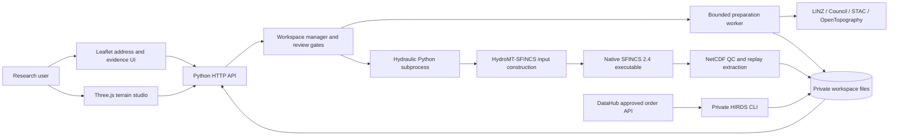
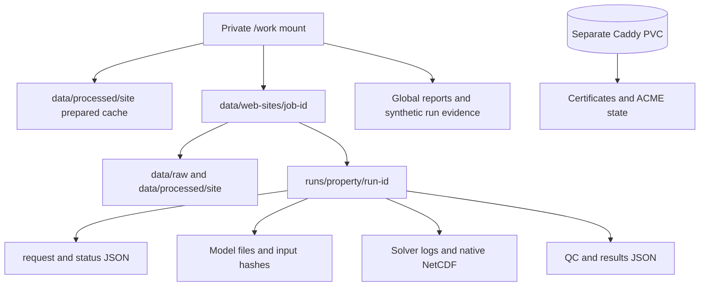
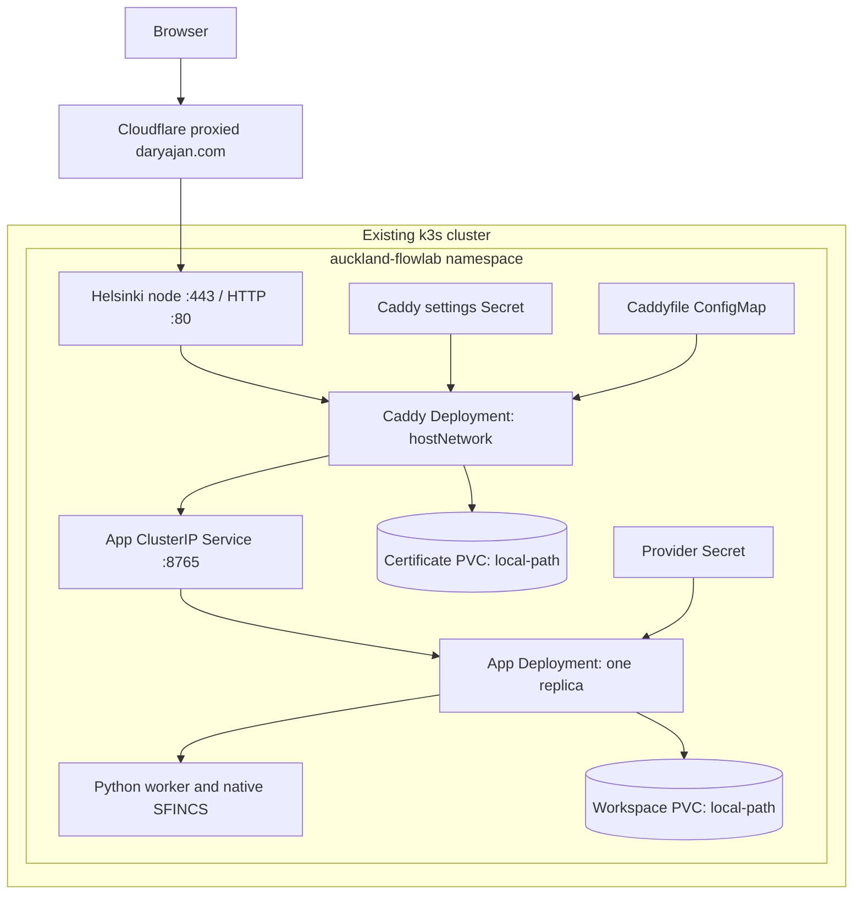

# Auckland FlowLab: software, infrastructure and operations architecture

> Historical operations snapshot: several sections describe the former hydraulic
> UI, not the current product. Start with [README](README.md) and
> [METHODOLOGY](METHODOLOGY.md) for the active boundary-review workflow. Keep this
> reference for restore/deployment history; verify operational state before use.

Implementation snapshot: **15 October 2026**. Numerical validation figures
retain their original 14 October evidence date. This document covers the actual
Windows/WSL development stack, browser/API/worker design, Docker packaging and
Helsinki Kubernetes deployment. For physical assumptions, source accuracy,
equations and simulation evidence, read the [archived hydraulic methodology](docs/archive/HYDRAULIC_METHODOLOGY_2026-10-15.md).

## Contents

- [System overview](#system-overview)
- [Tools and compatible versions](#tools-and-compatible-versions)
- [Repository map](#repository-map)
- [Address and simulation execution](#address-and-simulation-execution)
- [HTTP interface](#http-interface)
- [Storage and artifact lifecycle](#storage-and-artifact-lifecycle)
- [Development and reproducible builds](#development-and-reproducible-builds)
- [Docker Compose deployment](#docker-compose-deployment)
- [Kubernetes topology](#kubernetes-topology)
- [Traffic, TLS and authentication](#traffic-tls-and-authentication)
- [Configuration and credentials](#configuration-and-credentials)
- [Operations, verification and recovery](#operations-verification-and-recovery)
- [Security boundaries and scaling limits](#security-boundaries-and-scaling-limits)
- [Extension plan](#extension-plan)

## System overview

The frontend is static HTML/CSS/JavaScript served by a Python threaded HTTP server.
Leaflet provides the 2D workspace; Three.js provides the interactive terrain studio.
The backend resolves official source data and manages private file-backed jobs.
One bounded processing slot is shared between preparation and hydraulic execution.
An actual SFINCS subprocess solves hydraulics; browser animation replays its saved
results. There is no message broker, application database or Kubernetes Job per run.



DataHub downloads are a private CLI workflow, not an automatic purchase/order or
browser-side credential flow. QGIS/CloudCompare are optional desktop inspection
tools, not backend services. PostGIS and SWMM remain optional future components.

## Tools and compatible versions

The environment YAML constrains compatible families; `locks/` records exact tested
Conda builds and PyPI packages. Do not substitute today's latest packages without
revalidation. Versions below are from recorded activated runtime diagnostics.

| Component | Tested version/family | Responsibility |
|---|---|---|
| Python | 3.11.17 in recorded Linux runtime | CLI, API, providers, QC and workers |
| GDAL | 3.10.3 | Geospatial native drivers/reprojection |
| Rasterio | 1.4.3 | Raster windows, merge, masks and GeoTIFF |
| GeoPandas | 1.1.4 | Projected vector data and GeoPackage |
| PDAL core | 2.8 family in environment specification | Native point-cloud tooling |
| Python PDAL binding | 3.4.5 | Python pipeline access; binding version is not core version |
| laspy | 2.6.1 plus lazrs | LAS/LAZ flags/classes and geometry |
| NumPy / pandas / xarray | 1.26.4 / 2.2.3 / 2024.11.0 | Numeric grids, forcing time series, NetCDF |
| netCDF4 | 1.7.4 | Native hydraulic outputs |
| Affine | 2.4.0 | Compatible raster transforms; Affine 3 breaks tested PyFlwDir path |
| HydroMT / HydroMT-SFINCS | 0.10.1 / 1.2.2 | Verified pre-1.0 model-building APIs |
| SFINCS | 2.4.0 Galibier CPU | Actual hydraulic executable, separately installed |
| Three.js | 0.180.0 | WebGL terrain/structures/water display and exports |
| Leaflet | 1.9.4 | 2D map and layer controls |
| esbuild | 0.25.12 | Reproducible minified browser bundle |
| Caddy | Digest-pinned 2-alpine image | TLS and public reverse proxy |
| k3s | Recorded node 1.36.5+k3s1 | Existing single-node orchestration |
| QGIS / CloudCompare | Installed native tools; inspect local inventory for exact versions | Manual GIS/point-cloud review |
| SWMM | Separately verified engine 5.2.4 interface | Optional; no live coupling |
| PostGIS | Digest-pinned optional Compose image | Not initialized or used by current app |

SFINCS source container digest:
`sha256:4301bffc74f3cb3f334be5d21aa75dfe5742a16c9838942cdfc2f870859fb404`.
Caddy digest and optional PostGIS digest are in the tracked Compose/Kubernetes
files. Full exact builds are in [environment.yml](environment.yml),
[Conda lock](locks/conda-linux-64.lock), [pip lock](locks/pip-linux-64.lock),
[frontend package manifest](web/package.json) and its npm lockfile.

## Repository map

```text
src/floodtwin/
  api/                 HTTP routes, allowlisted assets and workspace orchestration
  providers/           Official provider access, metadata and DataHub downloads
  terrain/             Acquisition/processing, aerial crop and scene construction
  hydraulics/          Synthetic fixtures, quality suite and exploratory site solver
  ...                  Other geospatial/validation modules; inspect source tree
web/
  index.html, app.js, style.css      Main Leaflet/evidence workspace
  scene.html, scene.js, studio.css   Interactive Three.js studio
  package*.json                     Exact frontend dependency specification
scripts/               PowerShell/WSL setup, launch, diagnostics and source QC
deploy/
  Caddyfile             Compose proxy configuration
  k8s/                  Manifests, Caddyfile, secret/apply/validation helpers
locks/                  Exact tested Linux environment builds
tests/                  Automated offline/integration logic checks
docs/                   Focused setup, validation, UI, HIRDS and deployment guides
data/, runs/, reports/  Private ignored acquisition, models and evidence
configs/                Example/public specification plus ignored local site config
Dockerfile              Locked tooling/app image and bundled native solver
compose.yaml            Development tooling, standalone solver, optional PostGIS
compose.production.yaml Public own-node app/Caddy alternative
```

Generated `web/scene.bundle.js`, node_modules, native data, NetCDF, LAZ, `.env*`
values and validation/browser artifacts are ignored. Only example env files are
tracked. [.dockerignore](.dockerignore) also excludes private build-context content.
README/master-plan commands that are only future requirements must not be treated
as implemented APIs.

## Address and simulation execution

```mermaid
sequenceDiagram
    actor U as User
    participant B as Browser
    participant A as Python API
    participant W as Workspace manager
    participant P as Official providers
    participant S as SFINCS worker
    participant D as Private disk
    U->>B: Enter full address
    B->>A: Search with origin and session token
    A->>P: Official address/parcel resolution
    A-->>B: Candidate and review geometry
    U->>B: Confirm intended parcel
    B->>A: Explicit confirmation
    A->>W: Acquire processing slot; create workspace
    W->>P: Bounded data preparation
    W->>D: Sources, hashes, QC and progress
    B->>A: Poll job and inspect scene
    U->>B: Review storm, obstacles and assumptions
    B->>A: Reviewed hydraulic specification
    A->>W: Validate and acquire shared slot
    W->>D: Fresh run ID, request and running status
    W->>S: Separate Python worker and actual solver
    S->>D: Inputs, logs, NetCDF, QC and replay
    W->>D: Persist done or failed state
    B->>A: Poll/select saved run
    A-->>B: Validated replay with explicit limitations
```

Search is preparation for review, not permission to simulate. Confirmation creates
a new private workspace. Preparation steps include Council GIS, building outlines,
coverage discovery, DEM/DSM, native points, profiles, screening and evidence preview.
Their dependencies and event status are managed in `api/workspace.py`.

Hydraulic input validation enforces numeric bounds, explicit `reviewed: true` and
hypothetical wall status. A busy worker returns HTTP 409; there is no persistent
queue to consume an approval later. Scenario launch creates a UUID-derived run
directory and writes the reviewed request before execution.

The manager uses a daemon thread to supervise a separate Python process, which
launches the native solver. Worker timeout is 1,500 s; solver timeout is 1,200 s.
HTTP remains responsive while computation runs. Persisted states are `running`,
`done`, `failed` or `interrupted`; active records become interrupted after restart.
Preparation interrupted by restart requires a new search/confirmation. Scientific
input failures produce failed status, never substitute water.

## HTTP interface

The service is a `ThreadingHTTPServer`, not FastAPI/ASGI. The following are existing
routes; it is not an unrestricted file server.

| Method/path | Purpose |
|---|---|
| `GET /` | Main workspace UI |
| `GET /scene.html?job=<id>` | Terrain studio page; confirmed job fetched separately |
| `GET /healthz` | Process-level health, not proof of geospatial or hydraulic validity |
| `GET /api/bootstrap` | Session token, default site and runtime labels |
| `GET /api/lab` | Saved synthetic laboratory evidence |
| `POST /api/search` | Resolve an official candidate |
| `POST /api/confirm` | Confirm reviewed candidate and start preparation |
| `GET /api/jobs/<id>` | Confirmed job status/data readiness |
| `GET /api/jobs/<id>/scene` | Versioned real scene metadata/arrays/meshes |
| `GET /api/jobs/<id>/points` | Bounded display-decimated point cloud |
| `GET /api/jobs/<id>/layers/<name>` | Supported prepared GIS layer |
| `GET /api/jobs/<id>/terrain` | Prepared map terrain overlay |
| `GET /api/jobs/<id>/profiles` | Cross-section data |
| `GET /api/jobs/<id>/files/<name>` | Allowlisted evidence export |
| `POST /api/jobs/<id>/hydraulics` | Reviewed asynchronous exploratory run |
| `GET /api/jobs/<id>/hydraulics` | Saved run status list |
| `GET /api/jobs/<id>/hydraulics/<run>` | Status or completed replay/QC |

POST requests require a permitted Host, valid session token in `X-Floodtwin-Token`
and permitted Origin when supplied. JSON is bounded to 4,096 bytes; Caddy applies
an 8 KB upstream request-body cap. The server sends no-store responses, a restrictive
content security policy, MIME protections and sanitized errors. API JSON redacts
environment values whose names end in `_KEY`. Host/origin controls complement
input validation; the token is not a per-user permission system.

## Storage and artifact lifecycle



File-backed state avoids a database dependency and preserves raw evidence alongside
results. It also duplicates some prepared material between workspaces, so monitor
disk usage. No automated retention policy or off-node backup scheduler is installed.
Run directories are immutable in intent; the solver refuses an existing input
directory. Job/run identifiers are validated before filesystem access.

Workspace isolation is organizational, not tenant authorization. Anyone accessing the public portal can access confirmed workspaces by identifier. Multiple
app replicas would need durable scheduling/locking and ownership semantics; simply
increasing replicas is unsafe for the current in-process semaphore and file state.

## Development and reproducible builds

Windows 11 hosts native review tools and PowerShell wrappers; WSL2 Ubuntu-24.04
hosts the isolated micromamba `floodtwin` environment. Existing Windows Python
installations are not replaced. Docker Desktop supplies the Linux engine.

```powershell
# Run from the project root.
powershell -ExecutionPolicy Bypass -File scripts/setup.ps1
powershell -ExecutionPolicy Bypass -File scripts/validate.ps1
powershell -ExecutionPolicy Bypass -File scripts/start-app.ps1
# Open http://localhost:8765
```

Rebuild frontend assets with `npm --prefix web ci --ignore-scripts` followed by
`npm --prefix web run build`. Syntax checks use `npm --prefix web run check`.
The esbuild binary must be available in the restored node_modules environment.
Use [docs/SETUP.md](docs/SETUP.md) for locked restoration and optional tools.

In local WSL, `scripts/sfincs` is a Docker launcher for the pinned standalone
solver, mounting only the current run folder and disabling its network. The
production image bundles the native executable, so no Docker daemon or Docker
socket is exposed inside the application pod. Do not confuse these two execution
paths or assume installing HydroMT installs the solver.

The Dockerfile builds the frontend in a Node stage and installs the locked
geospatial environment/native solver in the runtime image. Runtime caches go
under writable `/tmp`; the persistent research directories are volume mounts.
Read-only runtime/resource tests have been performed. Source changes to docs
alone do not require a live application rebuild.

Project `.codex/config.toml` configures development MCP servers: read-only GitHub
reuses `gh` keyring authentication, and Playwright provides browser inspection.
These are developer tools, not application runtime dependencies or server-side
agents. Existing MCP integration checks passed; host reload/project trust may be
needed. The pinned Playwright MCP depends on an alpha browser runtime, disclosed
in setup documentation. Real browser QA was also performed with Playwright CLI.

## Docker Compose deployment

`compose.yaml` provides development tools, a separately pinned solver profile and
optional PostGIS. `compose.production.yaml` is the alternate own-node app/Caddy
deployment with private environment settings, named persistent volumes, health
checks, resource limits and no direct public application port.

```bash
docker compose --env-file .env.production -f compose.production.yaml config --quiet
docker compose --env-file .env.production -f compose.production.yaml up -d --build
```

These commands are for an independent Compose host. **Do not start Compose Caddy
on the live Kubernetes node while Kubernetes Caddy owns ports 80/443.** Production
Compose defaults to a larger 6 GB/4 CPU application allocation; override for the
actual machine rather than copying those defaults onto the 4 GB node.

The current Compose app passes LINZ/OpenTopography settings but does not pass
DataHub settings in its environment block. For approved HIRDS downloads in a
Compose container, explicitly add private `DATAHUB_CUSTOMER_ID` and
`DATAHUB_API_KEY` environment bindings, or run the private CLI in the local
environment. Merely adding values to a dotenv file does not inject unlisted
variables into a container. Kubernetes already receives them from its provider Secret.

Optional PostGIS requires `POSTGIS_PASSWORD`. Development exposes only
localhost:55432; production uses the internal network. It is not needed by current
file-backed jobs. Never use `down -v` or volume pruning during upgrades/recovery.
Full Compose commands/backup helpers: [docs/DEPLOYMENT.md](docs/DEPLOYMENT.md).

## Kubernetes topology

The active deployment is on the existing Helsinki k3s node, not AKS. Local user
context is `ravand`; remote kubectl context is `default`. Deployment helpers verify
the expected node UID before mutation. The recorded node is `ravand-k3s-01`,
2 CPU / 4 GB RAM. The 15 October rename migrated the dedicated application into
the `auckland-flowlab` namespace, copying and hash-verifying workspace and
certificate contents. The previous application's Deployments are scaled to zero,
with original volumes retained as a rollback copy. No unrelated application or
ingress was changed. Operations below refer to the active renamed deployment.



| Resource | Concrete configuration |
|---|---|
| Namespace | `auckland-flowlab` |
| App Deployment/Service | `auckland-flowlab-app`, one replica, ClusterIP TCP 8765 |
| Caddy Deployment/Service | `auckland-flowlab-caddy`, one replica; ClusterIP 80/443 and UDP 443 |
| Public path | Caddy **hostNetwork** binds node ports; ClusterIP is not an external load balancer |
| App image | `docker.io/library/auckland-flowlab-app:rename-20261015`, imported locally, `imagePullPolicy: Never` |
| Node selection | Both deployments pinned to `ravand-k3s-01` |
| Workspace PVC | `auckland-flowlab-workspace`, 8 Gi request, ReadWriteOnce, local-path |
| Certificate PVC | `auckland-flowlab-caddy`, 256 Mi request, ReadWriteOnce, local-path |
| App requests/limits | 250 mCPU / 512 Mi request; 1,500 mCPU / 2 Gi limit |
| Caddy requests/limits | 25 mCPU / 32 Mi request; 250 mCPU / 256 Mi limit |
| Threads/workers | `OMP_NUM_THREADS=1`; maximum one preparation/hydraulic worker |
| Rollout | `Recreate` for both; brief outage avoids RWO/host-port conflicts |
| App probes | HTTP `/healthz` with explicit loopback Host; startup/readiness/liveness |
| Caddy probes | TCP 80 readiness/liveness, not full certificate/upstream checks |
| DNS | Caddy `ClusterFirstWithHostNet` for internal service resolution |

App UID/GID is 57439; Caddy UID/GID is 1000. Both are non-root with read-only
root filesystems, no privilege escalation and dropped capabilities; Caddy adds
NET_BIND_SERVICE to bind low ports. App `/tmp` is a 512 Mi emptyDir; Caddy has
separate ephemeral config/cache storage. Workspace subpaths mount `/work/data`,
`/work/runs`, `/work/configs`, `/work/reports`. Init creates those folders without
altering existing data. Resource requests on local-path PVCs are not enforced
disk quotas and do not provide node-loss protection.

Traefik and ServiceLB were already disabled and node ports free. Do not enable a
second ingress/public listener without deliberately redesigning routing. Current
manifests have no Ingress, external LoadBalancer, NetworkPolicy, HPA or remote
object storage. These omissions are architectural limits, not hidden services.

Image import, Secrets/ConfigMap generation and dry-run/apply steps are detailed in
[docs/KUBERNETES.md](docs/KUBERNETES.md). `imagePullPolicy: Never` means another
node cannot start this image until it is imported there or a private registry/pull
policy is configured. No public image registry upload was required.

## Traffic, TLS and authentication

DNS A points to the Helsinki node through Cloudflare proxying; the user confirmed
Full (strict). Cloudflare terminates edge HTTPS and connects securely to Caddy.
Caddy obtained a publicly trusted Let's Encrypt origin certificate through an
actual challenge. Certificate state is persistent; no Cloudflare API key is
needed for the current HTTP-based certificate workflow.

Website BasicAuth was removed at the user's request on 15 October 2026. Caddy
proxies public HTTPS to `auckland-flowlab-app.auckland-flowlab.svc.cluster.local:8765`
without requiring credentials. It strips any Authorization header upstream.
Compression, HSTS, MIME protection, request limits and the 240 s upstream response
header timeout remain configured; Caddy administration remains disabled.

The portal, existing confirmed workspaces/exports and reviewed simulation controls
are publicly accessible. Provider keys remain server-side and private env routes
remain denied. Origin/Host/token checks constrain requests; they do not restrict
public users to their own jobs or act as account authentication. The origin is
directly reachable and is not restricted exclusively to Cloudflare IPs.
Retired login artifacts remain private archives and are no longer used. Current
secret-generation scripts create certificate/provider settings only.

The app CSP allows its bundled scripts and explicit map tile image providers.
Cloudflare-injected analytics was blocked by this policy during browser QA; app
rendering continued. Map tiles are contextual third-party imagery, separate from
the verified local LINZ orthophoto used by the terrain studio.

## Configuration and credentials

This is a names/status snapshot, never a record of secret values.

| Name | Purpose | Current requirement/state |
|---|---|---|
| `LINZ_API_KEY` | Address/parcel/building API access | Configured privately; needed for new official queries |
| `OPENTOPOGRAPHY_API_KEY` | Optional authenticated provider APIs | Stored privately; selected unsigned bulk path does not need it; no blanket API validation |
| `DATAHUB_CUSTOMER_ID` | Approved HIRDS account file access | Configured privately/local and Kubernetes Secret |
| `DATAHUB_API_KEY` | DataHub Bearer authentication | Configured; tested account API reports no approved orders |
| `ACME_EMAIL` | Certificate contact | Configured privately |
| `DOMAIN` / `PUBLIC_ORIGIN` | Compose routing/origin | daryajan.com; Kubernetes Caddyfile uses explicit domain |
| `FLOODTWIN_BIND` | API listener | Loopback local; 0.0.0.0 container |
| `FLOODTWIN_PUBLIC_ORIGIN` | Host/origin checks | Explicit https://daryajan.com in Kubernetes |
| `MAX_ACTIVE_JOBS` / `FLOODTWIN_MAX_ACTIVE_JOBS` | Compose wrapper / runtime capacity | One on live node |
| `OMP_NUM_THREADS` | Native solver CPU threads | One Kubernetes; configurable Compose defaults differ |
| `APP_MEMORY_LIMIT`, `APP_CPUS` | Compose runtime limits | Kubernetes uses manifest resources instead |
| `POSTGIS_PASSWORD` | Optional database initialization | Unset; unnecessary unless PostGIS enabled |

Windows `.env` is for private local settings; `.env.production` is the private
Compose/operator settings file. Kubernetes consumes `auckland-flowlab-provider-keys` and
`auckland-flowlab-caddy-settings`, not a mounted dotenv file. Secret staging files are
removed from the node after successful installation. Kubernetes Secrets are not
an authorization or encryption boundary against cluster administrators.

Manual prerequisites: WSL/virtualization/Docker/UAC where absent, SSH and cluster
administration, DNS/firewall access, `gh auth login` when required, HIRDS order and
licence review, consented survey access and scientific parameter review. Required
deployment settings were configured in the recorded deployment; missing HIRDS
rainfall is a data/order gap rather than an environment-variable gap.

## Operations, verification and recovery

Read-only cluster checks:

```bash
kubectl --context ravand -n auckland-flowlab get deployment,pods,svc,pvc
kubectl --context ravand -n auckland-flowlab logs deployment/auckland-flowlab-app --tail=50
kubectl --context ravand -n auckland-flowlab logs deployment/auckland-flowlab-caddy --tail=50
kubectl --context ravand -n auckland-flowlab exec deployment/auckland-flowlab-app -- /usr/local/bin/_entrypoint.sh floodtwin doctor
```

Use the Mamba entrypoint for geospatial exec commands; plain exec previously emitted
PROJ path warnings. `doctor` verifies the real geospatial/runtime dependencies;
health probes alone do not. Local full validation is `scripts/validate.ps1`.
The node helper `bash /opt/auckland-flowlab-deploy/validate.sh` runs eight real synthetic
cases and checks public HTTPS without credentials. It creates fresh
private evidence, so allow runtime/disk capacity.

Recorded evidence includes 41 automated test passes, eight synthetic hydraulic
case passes, 10 authenticated public smoke checks, real terrain/rain/dry/wall
browser replays, and production read-only resource-constrained checks. These are
dated results, not continuous monitoring. Site mass closure and calibration are
separate gaps documented in the methodology README.

Upgrade procedure:

1. Verify context/node, free disk, idle workers and private backup.
2. Build from tested locks; run relevant dependency/numerical/browser checks.
3. Tag/import the image into the correct node's k3s containerd; check identity.
4. Update app/init image references together and run server-side dry-run.
5. Apply only Auckland FlowLab resources, wait for rollout, inspect events/restarts.
6. Check public TLS, doctor and affected UI/run behavior.

Secret environment changes need pod restart. ConfigMap mounted via subPath also
needs Caddy restart. Never delete PVCs or namespace to refresh configuration.
Rollback uses `kubectl --context ravand -n auckland-flowlab rollout undo deployment/auckland-flowlab-app`
only when the previous image is still present on the node and compatible with
persisted artifacts. Recreate causes an outage; interrupted jobs are not resumed.

Back up when jobs are idle. Archive `/work/data`, `/work/runs`, `/work/configs`
and `/work/reports` privately through kubectl exec, and protect Secrets plus Caddy
certificate storage separately. Keep encrypted off-node copies and test restores;
no automated backup/restore drill is claimed. See the exact archive example in
[docs/KUBERNETES.md](docs/KUBERNETES.md).

| Symptom | First checks |
|---|---|
| Unexpected HTTP 401 | Check that the intended public Caddy configuration is active; no website login is configured |
| HTTP 403 on POST | Host/origin/token; reload after server restart; Cloudflare response separately |
| HTTP 409 | Shared worker occupied; wait and explicitly review/start again |
| Missing scene | Confirmed job/data coverage, scene version, bundle build, private preparation logs |
| Failed wall run | Footprint buffer conflict, input bounds, solver/QC logs; no automatic geometry invention |
| Pod OOMKilled | Events, memory limit and domain size; preserve failure evidence before changes |
| Image never pulls/starts | Locally imported tag on selected node; imagePullPolicy Never |
| Certificate/proxy failure | DNS/Cloudflare mode, node ports, Caddy logs, certificate PVC, service endpoints |
| DataHub no orders | Place approved point-table order; changing keys does not create rainfall data |

## Security boundaries and scaling limits

- Public shared research service; no per-job ownership or account authentication.
- No raw credentials in source, image, browser API or generated public manifests.
- Static/export allowlists; no arbitrary directory browsing or private `.env` route.
- Restrictive origin/Host/token checks; no general cross-origin mutation interface.
- One node, one replica, local storage and brief-outage upgrades; no high availability.
- Single processing semaphore and bounded subprocesses; no distributed scheduler.
- No installed metrics stack, alert manager, WAF policy management, automated
  retention, rate limiting or off-node backup service is claimed.
- Provider queries need outbound network; numerical solver computation itself is
  local. The application pod is not globally network-disabled.

The public outer Git repository originally contained a Git link without submodule
URL and the supplied ZIP. That checkout alone does not reproduce the completed
inner application. Deployment used the tested local source/image; repository
publication/submodule repair remains separate work. Never solve this by adding
private env, geodata, reports or images to the public repository.

## Extension plan

Scientific extensions: approved hyetographs, connected catchment/outlets, full
flux budgets, survey structures, roof runoff/drainage, validated difference maps.
Software extensions: authenticated user/job ownership, durable queue and worker
leases, versioned artifact schema, tested storage migration, backup automation and
metrics. Larger workloads need a capacity review before more replicas or domains.

PostGIS can later store spatial inventories; SWMM can later provide 1D pipes only
after tested timestep/head/volume coupling. Blender/photogrammetry can improve
measured visuals without changing hydraulic evidence. Each extension should retain
provenance, explicit assumptions and conservation checks rather than silently
changing the meaning of existing results.

Official infrastructure references: [K3s networking](https://docs.k3s.io/networking/networking-services),
[Kubernetes Services](https://kubernetes.io/docs/concepts/services-networking/service/),
[Caddy reverse proxy](https://caddyserver.com/docs/caddyfile/directives/reverse_proxy).


## Interactive workspace revision — 15 October 2026

The homepage now retains Leaflet evidence layers and adds a viewport map, compact
scenario panel and shared playback. `web/workspace.js` extends the existing
confirmation/preparation flow in `web/app.js`; `web/hydraulic.js` owns the colour
ramp and numerical layer selection used by both that workspace and `scene.js`.
`workspace.css` overrides the old dashboard layout. Long sources and profiles
remain in a modal; the full studio and its PNG/GLB exports remain available.

A single selected workspace/run/frame drives the embedded studio through
same-origin `postMessage`. Messages check origin, source window and workspace ID.
Late run responses are discarded; comparison data is cached in the studio.
Editing hypothetical walls does not change saved results: pending edits are
labelled and require a new solver run. Workspaces are never enumerated or borrowed
from another property. The existing public deployment still has no user ownership
or account isolation; knowing a confirmed workspace URL allows access.

Additional contracts:

| Endpoint | Contract |
| --- | --- |
| GET `/api/jobs/<id>/hydraulics/<run>` | Existing replay plus projected cell corners, active mask, native maxima, provenance and signed budget diagnostics |
| POST `/api/jobs/<id>/comparison` | `{baseline, modified}`; completed same-workspace runs, identical non-wall inputs/configuration, grids and timestamps required |
| GET/POST `/api/jobs/<id>/walls` | Persist reviewed hypothetical polylines using the solver coordinate/crest contract; atomic replacement |
| POST `/api/jobs/<id>/spatial` | Bounded local or WGS84 point list; pyproj transformation and nearest measured DEM samples |

`hydraulics/results.py` verifies native output hashes and compares every active
replay depth/velocity/timestamp with its NetCDF source before presenting it. It
uses native `hmax`, or `zsmax - zb`, for solver-step maxima; frame maxima are an
explicit fallback. Inactive building bed fills from old exporters are
canonicalised only in inactive cells. Native HDF5 reads are serialised to avoid
thread safety failures. Large responses use gzip when supported. No tile service,
database, new queue or infrastructure was added.

2D canvas polygons use individually projected native cell corners rather than
stretching a geographic bounding-box image. The 3D water uses one reusable buffer
with independent 4 m cell quads at native water-surface elevations, including only
wet active cells. Terrain occludes water below its measured ground surface.
There is no interpolated bridge across dry cells or animated synthetic water.

Scene version 6 adds conservative roof QA, triangle containment, coverage checks
and explicitly approximate DSM-median fallback roofs. Scene caches and wall saves
are written atomically. A processing failure preserves native outputs/logs. Worker
launch uses an explicit repository cwd; the full model lifecycle restores cwd
after HydroMT helper changes. Existing job capacity/timeouts remain in force.

The Docker frontend stage copies the shared hydraulic module before bundling.
See [the implementation and validation report](docs/INTERACTIVE_UPGRADE_REPORT.md)
for tests, private artifact locations, limitations and deployment/rollback gates.

Baseline/modified 2D swipe uses two clipped canvases sharing the same Leaflet
projection and timestamp; it does not blend water values or invent a transition.

## Earth studio — 15 October 2026

`hybrid.js` uses pinned CesiumJS 1.146's rendering widget and `@cesium/core`,
bundled locally. The widget avoids the full UI bundle's dynamic-eval dependency.
Workers/assets are served through a contained static path. `hybrid-model.js`
constructs an in-memory GLB solely from acquired terrain, native roofs,
approximate roof/facade fallbacks and aerial imagery. Display terrain samples
actual source heights every 2 m; water retains native 4 m cell values and masks.
Google geometry/textures never enter scientific inputs or exports.

`terrain/georeference.py` verifies a pinned LINZ NZGeoid2016 grid, applies h=H+N,
and checks a local projected-to-geocentric frame against exact transformations.
Residuals above 3 cm disable placement. At the reviewed site the numerical
residual is 5.7 mm and N=+34.630 m. These do not measure physical source alignment:
the display approximates NZGD2000/GRS80 as WGS84 without epoch deformation;
Google's photogrammetry offsets need independent control. Missing/changed grids
fail closed, leaving the existing terrain studio available.

Google is optional and disabled until a dedicated restricted browser key is
configured. Tiles stream directly; Hybrid clips to the measured model's edge
centres, LiDAR hides Google, Neighbourhood hides local simulation content. Credits
and the official logo remain visible. There is no Google prefetch, persistent
cache, export or extraction. No geocoder is provided in this viewer; independent
address-search controls are hidden while Google context is displayed. Live Google
coverage/clipping/alignment verification remains gated on credentials.

Terrain stays resident, previous water primitives are destroyed on state changes,
incoming messages coalesce, and two replays/one comparison are cached. Tile cache
is 128 MiB plus 32 MiB overflow (not total GPU memory). Rendering is demand-driven,
capped at 30 FPS, with reduced mobile detail and pause while hidden. Native arrows
are bounded and display-scaled. The original 2D and Three.js viewers remain.

`api/freshness.py` preserves acquisition records while checking allow-listed
public metadata with bounded requests and a one-hour in-process cache. Checks
do not establish newest site coverage, replace inputs or rerun simulations.
Credential/restart steps are in how-to-deploy.md.
